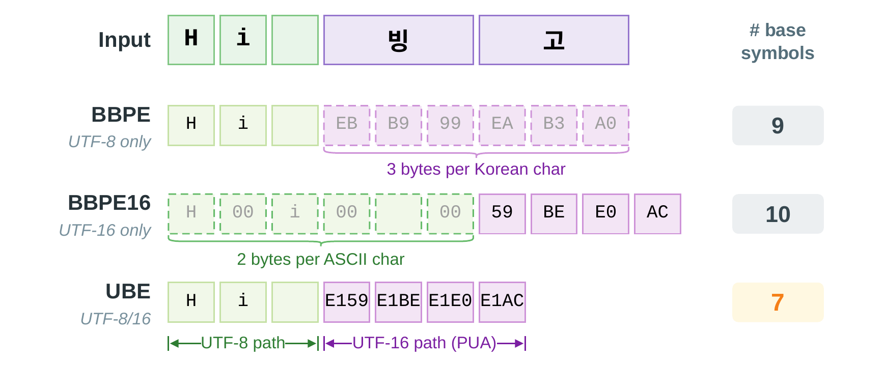
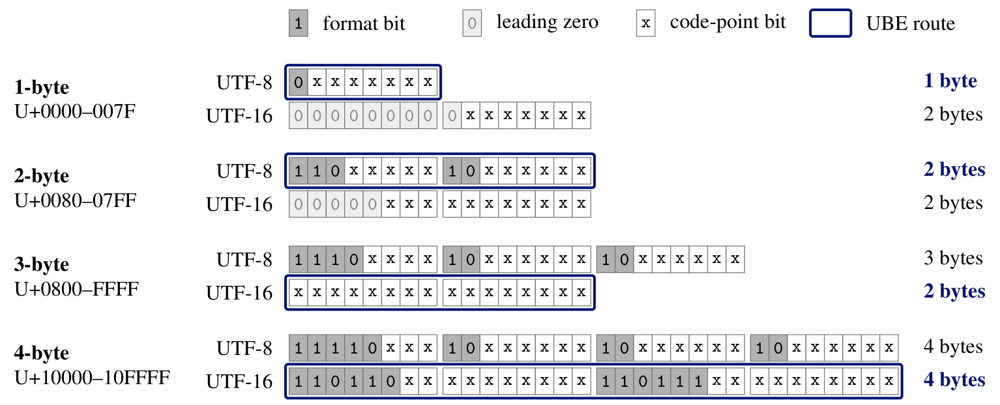
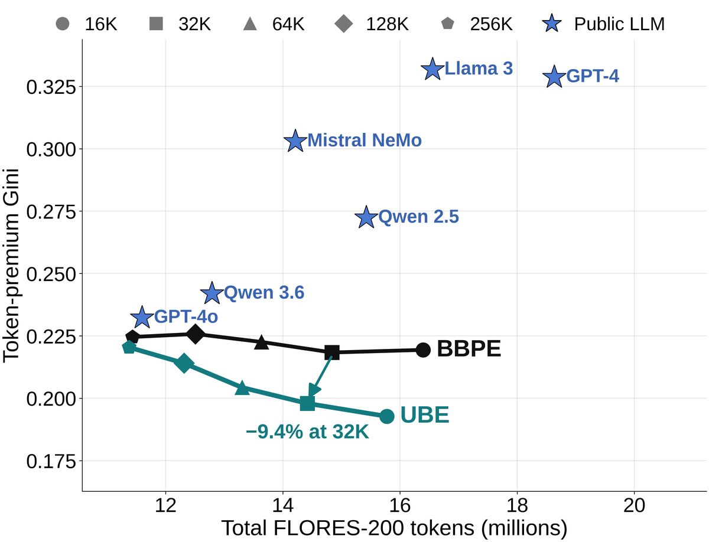
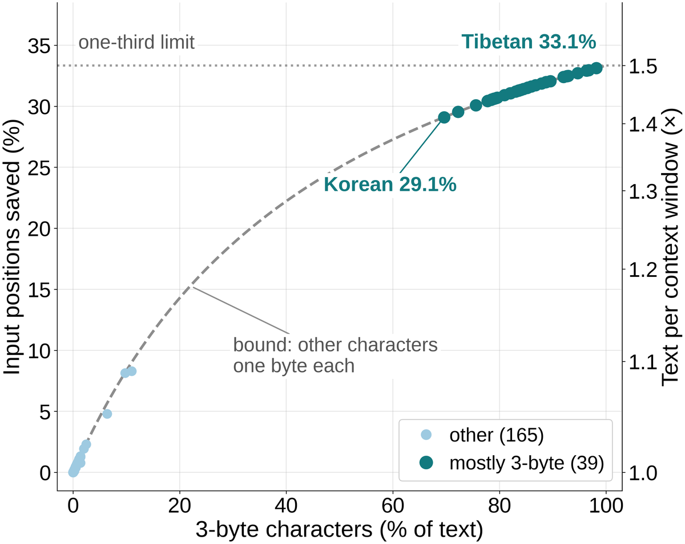

# Tokenizers with Universal Byte-Level Encoding (UBE)

[](https://neurips.cc/virtual/2026/loc/sydney/poster/152902)
[](https://arxiv.org/abs/2610.01984)
[](https://samsung.github.io/UBE/)

Hyunsik Kim and Youngmoon Jung, Samsung Research

**UTF-8 where it is compact, UTF-16 where it is not.** Lower cross-script disparity for BPE tokenizers, and up to
one-third shorter inputs for byte-level models.

<p align="center">
  
</p>
<p align="center"><em>UBE starts from 7 base symbols for "Hi 빙고", compared with 9 for UTF-8
byte-level BPE (BBPE) and 10 for UTF-16 BBPE16. UBE keeps ASCII in UTF-8 and writes each 3-byte BMP character as two
UTF-16 bytes from a separate alphabet.</em></p>

This repository is Hugging Face [`tokenizers`](https://github.com/huggingface/tokenizers)
v0.23.3 with the Universal Byte-Level Encoding (UBE) from
[**Universal Byte-Level Encoding: UTF-8/UTF-16 Routing to Reduce Cross-Script
Token-Budget Disparities**](https://arxiv.org/abs/2610.01984) (NeurIPS 2026).
The tokenizer implementation and the paper's FLORES-200, Unicode and MYTE-UBE
analyses are provided together here. See [paper/](paper/README.md) for the
analysis scripts, results and reproduction commands.

UBE is a byte representation for byte-level BPE that keeps BPE training and
merges standard, and an input representation for training byte-level models.
A character of one or two UTF-8 bytes keeps its UTF-8 bytes; a character of
three or four UTF-8 bytes is written with the bytes of its UTF-16LE code units.
The 3-byte characters of the Basic Multilingual Plane, used by Korean, Chinese,
Japanese, Indic, Thai, Ethiopic and many other scripts, therefore start from two
base symbols instead of three, while ASCII keeps exactly the bytes it had.

| Base symbols per character | 1-byte UTF-8 (ASCII) | 2-byte UTF-8 | 3-byte UTF-8 (BMP) | 4-byte UTF-8 (non-BMP) |
| :------------------------- | :------------------: | :----------: | :----------------: | :--------------------: |
| **UBE**                    |        **1**         |      2       |       **2**        |           4            |
| BBPE (UTF-8)               |          1           |      2       |         3          |           4            |
| BBPE16 (UTF-16)            |          2           |      2       |         2          |           4            |

By design, UTF-8 is less compact for 3-byte BMP characters: a 3-byte sequence (`1110xxxx 10xxxxxx 10xxxxxx`) spends
8 of its 24 bits on length and continuation markers that make UTF-8 self-synchronizing, leaving 16 code-point bits,
which UTF-16 stores in 2 bytes.

<p align="center">
  
</p>
<p align="center"><em>Bit layouts of each UTF-8 length class under UTF-8 and UTF-16, with code units drawn most
significant bit first (UBE writes them little-endian; surrogate pairs carry the code point minus 0x10000). UTF-16
saves a byte only for 3-byte BMP code points.</em></p>

These counts give the encoding floor: the base-symbol cost before BPE merging. With a 16K BBPE tokenizer trained on
101 languages, a FLORES-200 sentence in the seven languages written in Tibetan, Myanmar, Ol Chiki or Tifinagh
script takes 308.522 tokens on average and an English sentence 34.863, so the same context window holds only about
one-ninth as much parallel text in these scripts as in English.

### Tokenizers

- **Lower token-budget disparity.** On FLORES-200 with tokenizers trained on
  101 languages, the Gini coefficient of English-normalized token premiums
  falls from 0.2183 to 0.1979 (−9.4%) at a 32K vocabulary, and UBE uses fewer
  tokens in 189 of the 204 languages. The Gini is 6–14% lower in all nine
  core settings (English-only, 6-language and 101-language training at 16K,
  32K and 64K), and with the 101-language 32K tokenizers it also falls on the
  UDHR public-text stress test (−11.1%) and SIB-200, a topic-labeled subset of
  FLORES-200 (−8.5%).
- **Fewer tokens where they cost most.** With 101-language 16K tokenizers,
  Santali (Ol Chiki), Central Atlas Tamazight (Tifinagh) and Tibetan need
  29–34% fewer tokens. English needs fewer tokens too, at every tested
  vocabulary size in the paper's multilingual settings.
- **More text for the same budget.** Under a fixed token budget, Santali
  (Ol Chiki) fits 53% more text with 101-language 32K tokenizers, and English
  0.3% more. In a content-matched prompt-processing benchmark with a
  182M-parameter model and 6-language 32K tokenizers, the full-model prefill
  rate rises by 45.0% for Amharic and by 3.9% for English.
- **Robust to the training mixture.** With 30 GiB mC4 tokenizer-training mixtures
  that emulate GPT-4o, Mistral NeMo and a Chinese-centric scenario, UBE uses
  1.9–4.6% fewer tokens, lowers Other BMP tokens by 12.5–25.3% and the
  token-premium Gini by 5.5–11.7% in every pair, from 32K up to 200K
  vocabularies. English tokens fall in every pair as well, by up to 0.11%.
- **Same language-model quality.** In matched multilingual language-model
  experiments from 182M to 1.3B parameters and 32K to 128K vocabularies, UBE
  matches BBPE's quality.
- **Exact, with standard BPE.** Every Unicode 17 scalar value round-trips
  exactly. BPE training and merges are standard, and the routing needs no
  language identification or script table.
- **Composable.** UBE changes only the byte representation, so it composes with
  SuperBPE-style and SCRIPT-style boundary policies and MYTE's morphology maps
  while preserving those components. In matched FLORES-200 comparisons, UBE
  lowers mean sequence lengths for English, for the Other BMP group (seven
  languages written in Tibetan, Myanmar, Ol Chiki and Tifinagh scripts), and
  overall. With 32K tokenizers trained on the primary 101-language corpus,
  the Gini falls from 0.1922 to 0.1725 with SuperBPE-style boundaries and
  from 0.2036 to 0.1824 with SCRIPT-style boundaries.

<p align="center">
  
</p>
<p align="center"><em>FLORES-200 token-premium Gini against total tokens (lower left is better). The UBE and BBPE
curves use the same primary 101-language mC4 training corpus at 16K to 256K vocabularies. Stars mark public LLM
tokenizers evaluated on the same FLORES-200 text.</em></p>

| Mean tokens per sentence (101-language 32K) |         UBE |    BBPE | Change |
| :------------------------------------------ | ----------: | ------: | -----: |
| Santali (Ol Chiki)                          | **222.944** | 341.287 | −34.7% |
| Central Atlas Tamazight (Tifinagh)          | **183.305** | 269.166 | −31.9% |
| Tibetan                                     | **286.737** | 336.804 | −14.9% |
| Arabic                                      |  **60.407** |  60.600 |  −0.3% |
| English                                     |  **31.068** |  31.160 |  −0.3% |

### Byte-level models

- **Shorter inputs in more languages.** A byte-level model uses one input
  position per base symbol. On FLORES-200, UBE shortens the inputs of 202 of the
  204 languages, ties the other two and lengthens none (189 languages use
  fewer tokens with the 101-language 32K BPE tokenizer).
- **Large gains for 3-byte scripts.** In the 39 languages written mostly in
  3-byte characters, mean inputs are 29–33% shorter, so the same context window
  holds 1.41–1.50 times as much of this text.
- **Lower disparity.** The Gini coefficient of English-normalized premiums
  falls from 0.2077 to 0.1500, a 28% reduction, more than the 6–14% of the
  paper's core BPE settings.
- **English is shorter too.** The English mean is 0.04% lower: ASCII keeps
  one symbol per character, and 3-byte characters such as em dashes and curly
  quotes, 0.037% of FLORES-200 English, take two symbols instead of three.
- **Composes with MYTE.** MYTE-UBE preserves MYTE's morphology maps and decoded
  output while using 4.58% fewer base-symbol positions on FLORES-200: 201 of the
  204 languages have shorter inputs and the other three are tied.
- **The right byte first.** UBE writes the low byte first, so the first symbol
  of a 3-byte BMP character already identifies it among the 256 code points
  that share its high byte. This matters for hierarchical byte-level models
  that cut patches with a learned boundary predictor. In
  [The Right Byte First: How UTF-16 Helps Multilingual Boundary Prediction](https://arxiv.org/abs/2610.22071),
  small causal predictors with one-symbol lookahead reach 0.06% balanced
  grapheme-boundary error at code point boundaries on UBE input, versus 8.76% on
  UTF-8 and 8.62% on a big-endian variant of the same length, across 17
  languages in 13 Brahmic scripts, which implicates byte order beyond the
  shorter input alone. When the target keeps the parent tokenizer's cuts that fall on
  grapheme boundaries, UBE lowers boundary errors per 1,000 scalars relative to
  UTF-8 by 72.91% in Korean and 35.29% in Chinese, and its error falls below
  UTF-8's final error after 25% and 37.5% of training, respectively.

<p align="center">
  
</p>
<p align="center"><em>Input positions UBE saves against UTF-8 bytes for each of the 204 FLORES-200 languages,
before BPE merging. The 39 languages with at least half their characters encoded as 3 UTF-8 bytes have
29–33% shorter mean inputs, close to the one-third limit.</em></p>

| Mean base symbols per sentence (FLORES-200, no merges) |         UBE | UTF-8 bytes |  Change |
| :----------------------------------------------------- | ----------: | ----------: | ------: |
| Korean, Chinese, Japanese                              |  **91.252** |     133.665 | −31.73% |
| Other BMP (7 languages)                                | **277.056** |     406.632 | −31.87% |
| All 204 languages                                      | **176.088** |     196.106 | −10.21% |
| English                                                | **130.481** |     130.530 |  −0.04% |

## Installation

Use Python 3.10 or newer and a [Rust toolchain](https://rustup.rs) to build
from source, in a fresh virtual environment: the package keeps the name and
version of its upstream base (`tokenizers` 0.23.3).

```bash
python -m venv .venv
source .venv/bin/activate
pip install "git+https://github.com/Samsung/UBE@v0.23.3-ube.2#subdirectory=bindings/python"
```

## Usage

```python
from tokenizers.implementations import UniversalByteLevelBPETokenizer

tokenizer = UniversalByteLevelBPETokenizer()
tokenizer.train(
    files=["corpus.txt"],
    vocab_size=32000,
    min_frequency=2,
    special_tokens=["<s>", "<pad>", "</s>", "<unk>", "<mask>"],
)
tokenizer.save("tokenizer.json")

encoding = tokenizer.encode("Hi 빙고 🩷💚")
assert tokenizer.decode(encoding.ids) == "Hi 빙고 🩷💚"
```

A saved `tokenizer.json` loads with `Tokenizer.from_file`, like any other
tokenizer.

### Decoding parts of a sequence

`Tokenizer.decode` of a whole sequence and the streams of `decoders.DecodeStream`
decode UBE tokens as they are. `UniversalByteLevelDecoding` adds what decoding a
part of a sequence needs: the character boundaries between tokens, the start of
the token windows that incremental detokenizers decode, the text of token ids
cut at any position, and the text accumulated through tokens at character
boundaries.

```python
from tokenizers import Tokenizer, UniversalByteLevelDecoding

tokenizer = Tokenizer.from_file("tokenizer.json")
decoding = UniversalByteLevelDecoding(tokenizer)

ids = tokenizer.encode("前文的内容很长 and more").ids
# Align the requested start five tokens before the end of the prompt.
prefix_offset = decoding.aligned_offset(ids, len(ids) - 5)
# Token ids cut at any position: a cut character becomes one or more U+FFFD, the rest decodes exactly.
text = decoding.decode_slice(ids[3:])
# Text grouped at token positions that end at character boundaries, for per-token display.
pieces = decoding.token_texts(ids)
```

When integrating with window-based detokenizers, such as those of Text
Generation Inference and SGLang, use `aligned_offset` for the start of the first
window and of any later decode that starts inside the prompt. With 🤗
Transformers, pass the `backend_tokenizer` of a fast tokenizer.

## What this repository adds

- `pre_tokenizers.UniversalByteLevel`, `decoders.UniversalByteLevel` and
  `processors.UniversalByteLevel`, with the same options as their `ByteLevel`
  counterparts. In Rust, the pre-tokenizer and post-processor are
  `tokenizers::pre_tokenizers::universal_byte_level::UniversalByteLevel`, and
  the decoder is `tokenizers::decoders::universal_byte_level::UniversalByteLevel`.
- `pre_tokenizers.UniversalByteLevel.alphabet()`, the 512 base symbols: the
  256 byte symbols of `ByteLevel` for UTF-8 bytes and U+E100 to U+E1FF for
  UTF-16LE bytes.
- `tokenizers.implementations.UniversalByteLevelBPETokenizer`, which trains and
  loads UBE BPE tokenizers.
- `tokenizers.implementations.UniversalByteLevelDecoding`, which decodes parts
  of UBE token sequences (see [Decoding parts of a sequence](#decoding-parts-of-a-sequence)).

For the library's full API, see the upstream
[README](https://github.com/huggingface/tokenizers/blob/v0.23.3/README.md) and
[documentation](https://huggingface.co/docs/tokenizers).

## Paper analyses

[`paper/`](paper/README.md) contains:

- FLORES-200 devtest preparation and token-count, token-premium and Gini measurement.
- The Unicode 17 round-trip audit.
- MYTE-UBE composition, verification against MYTE's released implementation and
  base-symbol measurements.
- Decoding of FLORES-200 token sequences from the middle of a sentence: streams,
  detokenizer windows and slices.

The analysis dependencies are separate from the tokenizer package. Follow the
[setup and commands](paper/README.md#installation) from a clone of this repository.

## Tokenizers 1.0

[`v1/`](v1) holds UBE on `tokenizers` v1.0.0-rc.2, the 1.0 release candidate:
a `universal_byte_level` flag on the BPE model, loading of the `tokenizer.json`
files that `UniversalByteLevelBPETokenizer` writes with its default options, and
UBE training in Rust with `tk-train`. See [`v1/README.md`](v1/README.md).

## FAQ

Answers to common questions, drawn from the paper. Unless noted otherwise, sequence-length results are on FLORES-200
devtest (1,012 parallel sentences in each of 204 language–script pairs, hereafter languages), and BPE comparisons use
tokenizers trained on mC4 text. A token premium is a language's mean tokens per sentence divided by English's under
the same tokenizer; FLORES-200 Gini uses the 203 non-English premiums.

### The method

<details>
<summary><b>What is UBE in one sentence?</b></summary>

A per-character choice of byte encoding: UTF-8 where it is compact, UTF-16 where it is not, written in two disjoint
256-symbol alphabets so that decoding is exact. BPE training, merge semantics and the Transformer architecture stay
standard.

</details>

<details>
<summary><b>Why does UTF-8 cost some scripts more?</b></summary>

UTF-8 gets longer as code points get larger. ASCII takes 1 byte; many Cyrillic, Arabic and Hebrew characters take 2;
Korean, Chinese, Japanese, Devanagari, Thai, Tibetan and many other scripts have 3-byte BMP characters. A 3-byte BMP
character spends 8 of its 24 bits on length and continuation markers, and its 16 code-point bits fit in 2 bytes of
UTF-16. Where BPE has no merge for a character, each byte is one symbol, so the byte count is what the text pays: with a
101-language 16K BBPE tokenizer, a sentence of the Other BMP group (seven languages written in Tibetan, Myanmar, Ol
Chiki and Tifinagh scripts) takes 308.522 tokens on average, against 34.863 for English.

</details>

<details>
<summary><b>What exactly is the routing rule?</b></summary>

A character whose UTF-8 encoding has one or two bytes keeps those bytes. Every other character is written with the
bytes of its UTF-16LE code units, with no byte-order mark, so a 3-byte BMP character goes from 3 symbols to 2.
Characters outside the BMP, including many emoji, become surrogate pairs of 4 symbols, as many as in UTF-8, so no
character starts from more symbols than before. A character is one Unicode scalar value: combining marks and
zero-width-joiner sequences are routed scalar by scalar, with no normalization. The rule needs no language
identification and no script table.

</details>

<details>
<summary><b>How does the decoder know which encoding a symbol came from?</b></summary>

The two paths use disjoint alphabets, so no marker tokens are needed. UTF-8 bytes use the 256 byte symbols of GPT-2's
byte-level BPE, and UTF-16LE bytes use 256 Private Use Area symbols, U+E100 to U+E1FF. The decoder keeps a byte buffer
per alphabet and flushes it whenever the alphabet changes. This also works when a learned token spans both alphabets,
such as a token that holds a Latin letter and a Korean, Chinese or Japanese character.

</details>

<details>
<summary><b>What if the input text contains those Private Use Area characters?</b></summary>

There is no collision. A raw U+E100 is an ordinary 3-byte character, so it is written in UTF-16LE: its bytes 0x00 and
0xE1 become the symbols U+E100 and U+E1E1, and decoding rebuilds U+E100. The internal symbols stand for byte values,
not for text.

</details>

<details>
<summary><b>Is decoding exact?</b></summary>

Yes. The paper proves exact round-trip decoding, and all 204 FLORES-200 languages decode without a failure. An
exhaustive Unicode 17 audit covers every scalar value and the official normalization, grapheme-break and emoji test
suites, and UBE recovers every input. The audit is included in [`paper/`](paper/README.md).

</details>

<details>
<summary><b>Does streaming decoding work?</b></summary>

Yes. Streaming needs only the active alphabet and one pending byte buffer, and finished text is released at each
flush. A detokenizer that keeps its state from the first token, such as `decoders.DecodeStream`, reproduces every
sequence we tested. For tools that decode part of a sequence, `UniversalByteLevelDecoding.aligned_offset` finds a
character boundary for the start of a window; `decode_slice` uses parity to align the leading UTF-16 run of a slice
that ends at a character boundary (see
[Decoding parts of a sequence](#decoding-parts-of-a-sequence)). With the 101-language 32K tokenizers, the aligned
streams and continuations reproduce the expected text on all 206,448 FLORES-200 devtest sentences, and UBE places
fewer token boundaries inside characters than BBPE: 7.18% against 9.09% of interior token positions.

</details>

<details>
<summary><b>Why not use UTF-16 for everything?</b></summary>

UTF-16 writes every ASCII character as two bytes, doubling the base-symbol cost of ASCII text in English, code, digits
and markup. UBE keeps ASCII at one symbol and gives 3-byte BMP characters two. In the figure above, "Hi 빙고"
starts from 7 base symbols with UBE, 9 with UTF-8 BBPE and 10 with UTF-16 BBPE16.

</details>

<details>
<summary><b>What changes in BPE training or in the model?</b></summary>

UBE changes the byte representation used to train a new tokenizer. The base alphabet is the 512-symbol union of the
two byte alphabets; pair counting and merge selection are standard BPE, with no script-aware merge rule. Each tokenizer
is saved as a Hugging Face `tokenizer.json`, and models trained with it use an ordinary Transformer architecture.

</details>

### Tokenizers

<details>
<summary><b>What is the headline result for BPE tokenizers?</b></summary>

The Gini coefficient of English-normalized token premiums is lower with UBE than with BBPE in all nine core settings
(English-only, 6-language and 101-language training at 16K, 32K and 64K), by 6–14%, and the 95% paired-bootstrap
interval for the change, resampling non-English languages, lies below zero in each. It is also lower in the
101-language extensions at 128K and 256K. With the 101-language 32K tokenizers, Gini falls from 0.2183 to 0.1979,
189 of the 204 languages use fewer tokens, and the mean falls from 71.889 to 69.857 tokens per sentence.

</details>

<details>
<summary><b>Which languages gain the most?</b></summary>

Low-coverage scripts written in 3-byte BMP characters, which stay close to the encoding floor. With the 101-language
32K tokenizer, Santali (Ol Chiki) needs 34.7% fewer tokens, Central Atlas Tamazight (Tifinagh) 31.9% fewer and
Tibetan 14.9% fewer, so a fixed token budget holds 53% more Santali text.

</details>

<details>
<summary><b>Does UBE change English token counts?</b></summary>

English needs fewer tokens too. With multilingual tokenizer training (the paper's 6-language and 101-language
settings), English token counts are lower at every tested vocabulary size; with the 101-language 32K tokenizer they
fall from 31.160 to 31.068 tokens per sentence. English is also lower in all ten pairs of the emulated commercial
mixtures below. UBE leaves the ASCII base stream unchanged; English counts fall because 3-byte characters take two
base symbols, so BPE spends fewer merges on them and more on ASCII subwords. A routed BMP character can be completed by
one merge where BBPE needs two, and across the eight 6-language and 101-language settings, UBE spends 505–684 fewer
merges on 3- and 4-byte characters and partial characters and gains mostly ASCII-only subwords (214–370 more).
Byte-level English inputs are 0.04% shorter as well: 3-byte characters such as em dashes and curly quotes, 0.037% of
the characters in FLORES-200 English, take 2 symbols instead of 3.

</details>

<details>
<summary><b>Does the gain hold at large vocabularies?</b></summary>

Yes. With 101-language training, UBE's Gini stays below BBPE's from 16K to 256K. With the emulated commercial
mixtures, Gini is 5.5–10.0% lower at 128K–200K, and the Other BMP reductions persist up to 200K. The gains are
largest for compact vocabularies of 16K–64K, as in on-device models, and for byte-level models, which learn no merges.

</details>

<details>
<summary><b>Does it hold on other evaluation sets?</b></summary>

Yes. With the 101-language 32K tokenizers, Gini falls by 11.1% on the UDHR public-text stress test. It also falls by
8.5% on SIB-200, a topic-labeled subset of FLORES-200. A scan of 89.47M mC4 documents from the training shards finds
no document identical to a FLORES-200 sentence.

</details>

<details>
<summary><b>Does it hold for commercial-scale tokenizer training?</b></summary>

Yes. We emulated the training-language mixtures that Hayase et al. (NeurIPS 2024) inferred for GPT-4o and Mistral
NeMo, plus a Chinese-centric scenario, each as 30 GiB of mC4 text, and trained UBE and BBPE tokenizers at 32K–200K.
In all ten pairs, including a second corpus sample, UBE uses 1.9–4.6% fewer tokens, 12.5–25.3% fewer Other BMP tokens
and fewer English tokens, and lowers Gini by 5.5–11.7%.

</details>

<details>
<summary><b>Does UBE work on code?</b></summary>

Yes. Using the primary 101-language 32K tokenizers, we compared 100 SWE-bench issue texts and their ten released MAPS
translations. UBE uses fewer tokens than BBPE in all 11 languages when counts are summed over the 100 tasks, both for
issue text alone and with the complete contents of the edited code files.

</details>

<details>
<summary><b>Can UBE be combined with SuperBPE or SCRIPT-BPE?</b></summary>

Yes. UBE changes only the byte representation, so it composes with boundary policies. With 32K tokenizers trained on
the primary 101-language corpus and SuperBPE-style boundaries applied to both, UBE lowers Gini relative to BBPE from
0.1922 to 0.1725; with SCRIPT-style boundaries, from 0.2036 to 0.1824. In both cases UBE also uses fewer tokens.

</details>

### Byte-level models

<details>
<summary><b>Why are input-length gains larger for byte-level models?</b></summary>

A byte-level model reads one input position per base symbol and learns no merges, so every character pays its full
encoding floor, and UBE removes one symbol from every 3-byte BMP character. Against UTF-8 bytes, mean input lengths fall
by 31.73% for Korean, Chinese and Japanese (Chinese in both scripts and Cantonese included), by 31.87% for the Other BMP
group and by 0.04% for English, total positions fall by 10.21%, and the Gini coefficient falls from 0.2077 to 0.1500,
28% lower.

</details>

<details>
<summary><b>Where does "up to one-third shorter" come from?</b></summary>

A 3-byte BMP character drops from 3 symbols to 2, so text made only of such characters gets exactly one-third shorter.
If a share p of the characters is 3-byte and the rest 1-byte, the saving is p/(1 + 2p). In Korean FLORES-200 text, the
3-byte share is 69.6% and the measured saving is 29.10%; in Tibetan text the share is 98.2% and the saving is 33.13%.
In all 39 languages in which at least half the characters are 3-byte BMP characters, inputs are 29.10–33.13% shorter.

</details>

<details>
<summary><b>What does "1.41–1.50 times as much text" mean?</b></summary>

A fixed context window holds 1/(1 − saving) times as much text: 1/(1 − 0.2910) ≈ 1.41 for Korean and
1/(1 − 0.3313) ≈ 1.50 for Tibetan.

</details>

<details>
<summary><b>Does any language get longer at the byte level?</b></summary>

No. Inputs are shorter in 202 of the 204 languages, and the other two, Catalan and Central Kurdish, are tied because their
devtest text has no 3-byte character.

</details>

<details>
<summary><b>How does UBE relate to MYTE?</b></summary>

The two compose. Keeping MYTE's released decomposition and morphology maps fixed and routing only the remaining
characters through UBE gives MYTE-UBE, which decodes to the same output as MYTE with 4.58% fewer base-symbol positions
overall, 24.08% fewer for Korean, Chinese and Japanese and 29.13% fewer for the Other BMP group. It is shorter in 201 of
the 204 languages, tied in 3 and longer in none.

</details>

### Language models and speed

<details>
<summary><b>How does UBE affect language-model quality?</b></summary>

In the main multilingual experiments, where the corpus, architecture, optimizer and token-step budget are fixed and
only the tokenizer changes, UBE matches BBPE's quality, and checks at 230M/64K, 329M/128K and 1.3B/32K agree. A separate
comparison uses five 32K tokenizers (UBE, BBPE, BBPE16, MYTE+BPE and SCRIPT-BPE) trained on approximately 50 MiB of mC4
text per language across 101 languages. With 182M-parameter models and matched supervised UTF-8 byte
exposure, UBE has the lowest bits-per-byte (BPB) Gini and the highest multilingual and English benchmark-group means,
with benchmarks weighted equally within each group.

</details>

<details>
<summary><b>Can UBE speed up prompt processing?</b></summary>

Yes. A content-matched prefill benchmark uses one fixed five-sentence FLORES-200 bundle per language (6-language 32K
tokenizers, a 182M-parameter model, A100 80 GB, batch 1, FP32, `torch.compile`). With prompts already tokenized and on
the GPU, the Amharic bundle needs 32.1% fewer tokens and its full-model prefill rate in sequences per second rises by
45.0%; the English bundle needs 1.3% fewer tokens and its prefill rate rises by 3.9%. Amharic is outside the six
tokenizer-training languages.

</details>

### Practical questions

<details>
<summary><b>Where is UBE most useful?</b></summary>

- Compact vocabularies of 16K–64K, for example in on-device models.
- Low-coverage scripts written in 3-byte BMP characters, which stay near the encoding floor.
- Byte-level models, which learn no merges.

Under commercial-style training mixtures, the Other BMP and Gini reductions persist up to 200K.

</details>

<details>
<summary><b>What data were the paper's tokenizers trained on?</b></summary>

mC4 raw text. The core matrix covers English-only, 6-language (English, Korean, Chinese, Japanese, Hindi and Thai) and
101-language corpora at 16K, 32K and 64K, and the 101-language corpus also at 128K and 256K. Within each corpus and
vocabulary size, UBE and BBPE see exactly the same raw data. Measured in stored Arrow data, the 101-language corpus
targets about 100 GiB of English, 30 GiB each of Korean, Chinese, Japanese, Hindi and Thai, and 1 GiB for each of the
other 95 languages.

</details>

<details>
<summary><b>How were the paper's language models trained?</b></summary>

All models are decoder-only LitGPT/LLaMA-style Transformers. Within each core and scale-check setting, the 101-language
mC4 corpus, architecture, optimizer and token-step budget are fixed, and only the tokenizer changes; in the primary
101-language 32K setting, UBE and BBPE are matched to within 0.3% in raw-text coverage. The separate comparisons across
additional tokenizer families match cumulative supervised UTF-8 byte exposure. Evaluation uses held-out per-language
bits per byte (BPB) on mC4 and zero-shot multilingual and English benchmarks.

</details>

## Citation

```bibtex
@inproceedings{kim2026ube,
  title     = {Universal Byte-Level Encoding: {UTF-8}/{UTF-16} Routing to Reduce Cross-Script Token-Budget Disparities},
  author    = {Kim, Hyunsik and Jung, Youngmoon},
  booktitle = {Advances in Neural Information Processing Systems},
  volume    = {39},
  year      = {2026},
  url       = {https://arxiv.org/abs/2610.01984}
}
```

For UBE with byte-level models and boundary prediction, please also cite:

```bibtex
@article{kim2026rbf,
  title   = {The Right Byte First: How {UTF}-16 Helps Multilingual Boundary Prediction},
  author  = {Kim, Hyunsik},
  journal = {arXiv preprint arXiv:2610.22071},
  year    = {2026},
  url     = {https://arxiv.org/abs/2610.22071}
}
```

## License

This repository is a modified version of Hugging Face
[`tokenizers`](https://github.com/huggingface/tokenizers). The Hugging Face code
keeps its Apache License 2.0; see `LICENSE`. The UBE modifications and additions,
including the `paper/` code, are Copyright 2026 Samsung Electronics Co., Ltd. and
are licensed under the Creative Commons Attribution-NonCommercial-ShareAlike 4.0
International License (CC BY-NC-SA 4.0); see `LICENSE-CC-BY-NC-SA-4.0`. `NOTICE` lists
the added and modified files.
